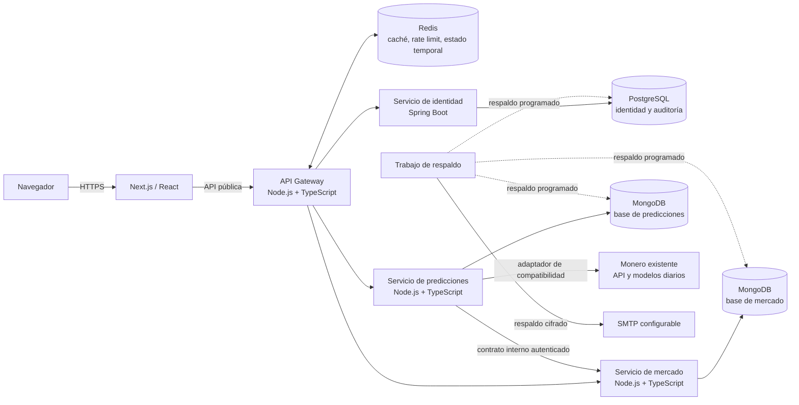

# Arquitectura objetivo — AyLZz Crypto Lab

Este documento define la arquitectura objetivo y una ruta de migración aditiva.
No describe una implementación ya desplegada: el Compose actual continúa usando
el frontend estático y la API de `Monero/`.

## Límites de la migración

- `Monero/` es un componente legado protegido: no se reescribe ni se modifica.
  Los servicios nuevos lo consumen mediante un adaptador HTTP.
- El frontend actual es la referencia visual y funcional. Se conserva hasta que
  la versión Next.js pase validaciones de comportamiento y comparación visual.
- Los documentos Word del proyecto sustentan el contexto experimental, el
  contrato de predicción y la comunicación responsable; no especifican un
  sistema visual alternativo. La paleta existente de rojos y negros se mantiene
  como punto de partida y se valida al migrar cada pantalla.
- Ninguna predicción es asesoría financiera. Los resultados y su incertidumbre
  deben seguir presentándose como experimentales.

## Vista de contenedores

El gateway es el único punto de entrada público para las API. Las llamadas
entre servicios se mantienen dentro de la red privada y usan identidad de
servicio, autorización mínima y contratos versionados; no se comparten
credenciales ni se accede directamente a la base de otro servicio.

## Servicios y propiedad de datos

| Componente | Tecnología | Responsabilidad y datos propios |
|---|---|---|
| Frontend | Next.js, React, TypeScript | Interfaz, idioma, preferencias de accesibilidad y hora local. Solo consume el gateway. |
| API Gateway | Node.js, TypeScript | Enrutamiento, validación de borde, límites de petición, correlación y políticas de resiliencia. Es dueño de su almacén Redis aislado para rate limiting y estado temporal; no guarda datos de negocio. |
| Identidad y seguridad | Java, Spring Boot | Registro, inicio/cierre de sesión, autorización y auditoría de identidad. PostgreSQL propio. |
| Mercado | Node.js, TypeScript | Series OHLCV, metadatos de fuente e intervalos disponibles. Base MongoDB propia. |
| Predicciones | Node.js, TypeScript | Solicitudes, resultados, métricas y referencia a la ejecución/modelo. Base MongoDB propia; inicialmente adapta el contrato diario de `Monero/`. |
| Respaldo | Trabajo operativo programado | Copias cifradas y envío por correo. No es una API pública ni una fuente de datos de negocio. |

Cada almacén tiene un propietario único y credenciales separadas; el Redis del
gateway no se comparte como almacén entre servicios. Para
inspección local, PostgreSQL puede abrirse en DBeaver y MongoDB en Compass
mediante un perfil local con puertos enlazados a `127.0.0.1`; esos puertos no se
publican en despliegues. Redis es efímero y no sustituye la persistencia de
identidad, mercado o predicciones.

## Contratos, seguridad y resiliencia

- El navegador no conoce direcciones internas ni credenciales de servicios.
- El gateway enruta por contrato y devuelve el estado HTTP y un cuerpo de error
  explícito; no convierte fallos del backend en respuestas exitosas.
- Los límites por ruta/identidad/IP se respaldan en Redis. Al excederlos, la
  API responde `429 Too Many Requests` y aplica `Retry-After` cuando proceda.
- Cada llamada saliente tiene timeout y presupuesto de reintentos acotado y
  configurable. Solo se reintentan operaciones idempotentes o solicitudes con
  clave de idempotencia; se aplican backoff y circuit breaker para evitar
  tormentas de reintentos y esperas infinitas.
- Los servicios validan autorización en su frontera. Las llamadas internas usan
  credenciales de servicio de alcance mínimo; compartir una base de datos no es
  un mecanismo de integración.
- Logs estructurados, auditoría de acciones de identidad, métricas y trazas
  correlacionadas atraviesan gateway y servicios. No se registran contraseñas,
  tokens ni datos sensibles.

## Mercado, gráficos y tiempo

La interfaz debe conservar las vistas de velas y línea y admitir indicadores
cuando el contrato de datos los soporte. Para los rangos intradía solicitados,
el servicio de mercado necesita una fuente que entregue velas verificables de
1 minuto (últimos 10 minutos) y 5 minutos (últimas horas). La API diaria actual
de `Monero/` no puede producir esos intervalos: hasta seleccionar y validar una
fuente intradía, la UI debe declararlos no disponibles en vez de interpolarlos
o duplicar precios.

Los servicios guardan fechas en UTC y devuelven timestamps con zona explícita.
La UI los muestra en la zona local detectada por el navegador y ofrece controles
de idioma y accesibilidad. La legibilidad se valida en escritorio y móvil, con
etiquetas de ejes, intervalos, contraste y navegación por teclado.

## Despliegue, respaldos y configuración

- Docker Compose mantiene en paralelo la aplicación actual y los nuevos
  componentes mientras dura la migración; ningún cambio de fase debe dejar el
  portal anterior inejecutable.
- Configuración separada por ambiente. Secretos, credenciales de bases,
  configuración SMTP y destinatario de respaldos se inyectan desde el entorno,
  nunca se guardan en Git.
- Los respaldos periódicos deben cubrir cada base persistente, cifrarse antes de
  enviarse por correo y documentar retención, restauración y verificación.
- Los health checks, métricas, logs y trazas deben permitir detectar fallos por
  servicio y correlacionar una petición sin exponer información sensible.

## Fases de migración

1. **Base arquitectónica (esta fase):** registrar decisiones, propiedad de
   datos, contratos y restricciones; no cambiar el runtime.
2. **Infraestructura aditiva:** redes y configuración Docker por ambiente,
   health checks, PostgreSQL, MongoDB por servicio y Redis; mantener el Compose
   existente operativo.
3. **Gateway:** servicio Node/TypeScript con rutas, timeouts, reintentos
   idempotentes, límites Redis, errores HTTP y observabilidad.
4. **Identidad:** Spring Boot + PostgreSQL; registro e inicio de sesión reales,
   autorización, auditoría y pruebas de integración.
5. **Mercado y predicciones:** servicios Node/TypeScript con bases MongoDB
   independientes; adaptador hacia `Monero/` sin modificarlo. Seleccionar y
   validar fuente intradía antes de habilitar los intervalos 1m/5m.
6. **Frontend Next.js:** migrar una pantalla a la vez desde la UI existente,
   implementar autenticación con el gateway, idioma, accesibilidad, hora local
   y gráficos; comparar la equivalencia visual/funcional antes de retirar rutas
   antiguas.
7. **Operación y cierre:** respaldo cifrado y restauración probada, pruebas
   integrales, seguridad, diagramas finales, ADRs y guías operativas.

Cada fase se añade antes de retirar, incluye las pruebas que cubren su contrato,
se integra en Docker y termina con un commit independiente. No se inicia una
fase destructiva si la anterior no deja una ruta ejecutable y reversible.
