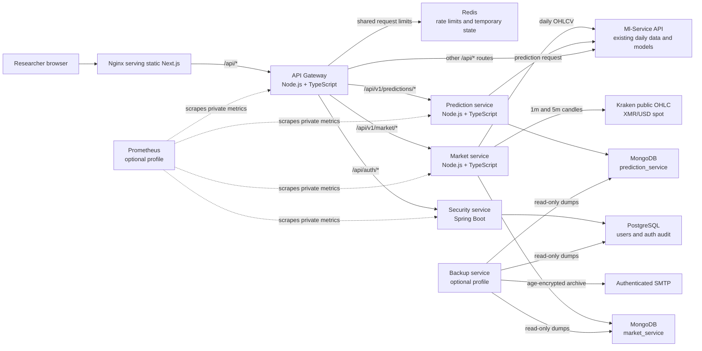
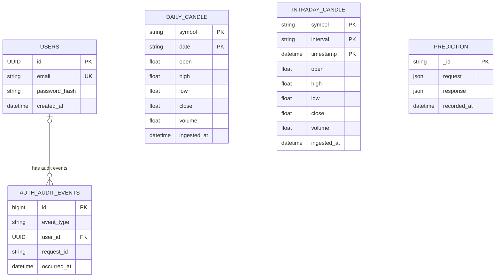
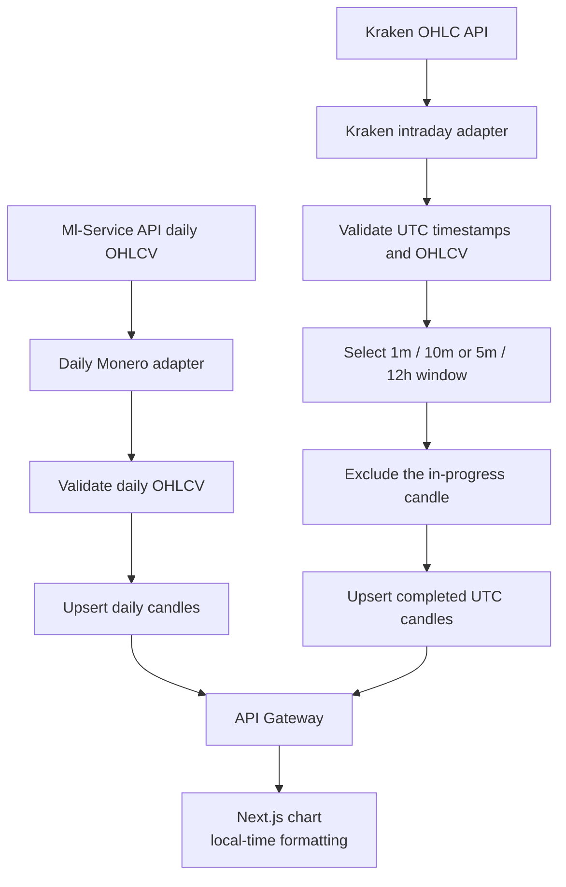
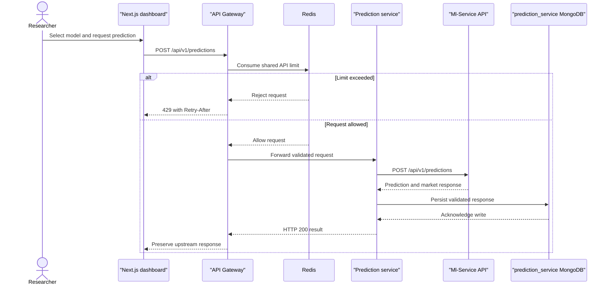

# Architecture diagrams

The diagrams describe the deployed local Compose topology. The optional backup
and Prometheus profiles are shown separately from request traffic.

## Service architecture and data ownership

## Data model and ownership

PostgreSQL is owned by the security service. Each MongoDB database is restricted
to its owning service; the gateway and other services do not query these
databases directly.

The market collection keys correspond to the unique MongoDB indexes:
`(symbol, date)` for daily candles and `(symbol, interval, timestamp)` for
intraday candles. Intraday documents expire 24 hours after their last
ingestion. Prediction request/response payloads are validated service
contracts, not relational tables.

## Market data ingestion

Daily and intraday data remain separate. Provider failure is reported; the
service does not resample daily values or silently fall back to another source.

## Prediction request

The gateway and services do not retry prediction POSTs automatically. The
prediction service owns its MongoDB writes and does not access the market
service database.
